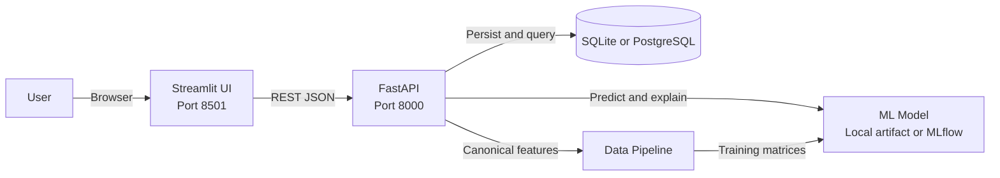

# Student Career Readiness Predictor

End-to-end ML platform predicting junior developer job readiness with FastAPI, Streamlit, SHAP explainability, and experiment tracking.

## Tech Stack

Python 3.11 | FastAPI | Streamlit | Docker | SQLAlchemy | MLflow | pytest | Ruff | SHAP | XGBoost

## Quick Start

Docker Compose starts the Streamlit frontend, FastAPI backend, and PostgreSQL database:

```bash
git clone <repository-url>
cd <repository-directory>
docker compose up --build
```

- Streamlit: [http://localhost:8501](http://localhost:8501)
- FastAPI documentation: [http://localhost:8000/docs](http://localhost:8000/docs)
- API health check: [http://localhost:8000/health](http://localhost:8000/health)

The frontend waits for the API service, and the API waits for PostgreSQL to pass its health
check. The `data/` and `models/` directories are mounted read-only in application containers.

When `API_BASE_URL` is not set, Streamlit runs the same FastAPI application in-process. This
keeps single-service hosts such as Streamlit Community Cloud functional without changing the
UI or duplicating prediction logic. Set `API_BASE_URL` to use a separately hosted API.

## Architecture



The Streamlit layout retains the Prediction, Batch Upload, Analytics, and About views. Model
operations run through FastAPI, while SQLAlchemy stores individual prediction history.

## Features

- Single-student readiness score, confidence interval, and Web Dev, Data, DevOps, or Mobile fit
- Batch prediction for up to 100 profiles per API request with CSV download in Streamlit
- Role-specific skill-gap recommendations and global feature importance
- Six candidate regressors with MLflow metrics, artifacts, SHAP summaries, and model registry
- SQLite local persistence, PostgreSQL container persistence, structured logs, and API metrics

## API Documentation

FastAPI generates the OpenAPI interface at `/docs`. Main endpoints are:

Predictions are persisted to the configured database. A single `/predict` request stores one
student and prediction record, while `/batch_predict` stores every student and prediction in
the batch using one transaction.

| Method | Path | Purpose |
|---|---|---|
| GET | `/health` | Service and model readiness |
| POST | `/predict` | Persist and return one prediction |
| POST | `/batch_predict` | Return predictions for 1 to 100 students |
| POST | `/skill_gap` | Compare a profile with a target role |
| GET | `/history?limit=50` | Return recent persisted predictions |
| GET | `/metrics` | Return request latency and prediction counters |

Single prediction:

```bash
curl -X POST http://localhost:8000/predict \
  -H 'Content-Type: application/json' \
  -d '{
    "tenth_mark": 78,
    "twelfth_mark": 76,
    "college_mark": 80,
    "github_activity_proxy": 6,
    "side_projects_count": 3,
    "internship_experience": 1,
    "tech_skills_self_rating": 7
  }'
```

Batch prediction:

```bash
curl -X POST http://localhost:8000/batch_predict \
  -H 'Content-Type: application/json' \
  -d '{
    "students": [
      {"tenth_mark": 78, "twelfth_mark": 76, "college_mark": 80},
      {"tenth_mark": 66, "twelfth_mark": 70, "college_mark": 72}
    ]
  }'
```

## Model Info

The pipeline aligns 14 canonical inputs and engineers three relevance scores. Domain scores are
reported separately for Web Dev, Data, DevOps, and Mobile. Candidate models are Random Forest,
Gradient Boosting, SVR, Linear Regression, XGBoost, and LightGBM.

`src/training.py` logs `cv_mae`, `test_mae`, and `test_rmse` for every candidate. It also logs a
fitted pickle, feature-importance CSV, and SHAP summary plot. The lowest-CV-MAE model is
registered as `student-readiness-model` with the `latest` alias. At runtime, the predictor loads
that registry alias when `MLFLOW_TRACKING_URI` is set, otherwise it uses
`models/student_career_willingness_model.pkl`.

Readiness scores are estimates, not hiring decisions. Confidence intervals reflect residual
variation in the training sample and do not establish causal effects.

## Data

The default training set contains exactly 450 public records:

| Dataset | Records | Public origin | Target |
|---|---:|---|---|
| Student Attitude and Behavior | 235 | [Kaggle, sahilislam007](https://www.kaggle.com/datasets/sahilislam007/student-attitude-and-behavior) | Self-reported career willingness |
| Factors Affecting Campus Placement | 215 | [Kaggle, Ben Roshan](https://www.kaggle.com/datasets/benroshan/factors-affecting-campus-placement) | Actual placed or not-placed outcome |

Known limitations:

- The combined sample is small and mixes two different student populations.
- The 235-row target is self-reported and can contain reporting or desirability bias.
- The placement dataset covers MBA students, not specifically junior software developers.
- Geographic and demographic diversity is not documented well enough to claim broad validity.
- GitHub activity and some developer attributes are engineered proxies, not direct measurements.

Optional synthetic data is for load testing and experimentation only. It mirrors observed means
and standard deviations and applies skill correlations such as React implying JavaScript with
90% probability. Generated CSVs are excluded from Git and are never loaded unless
`USE_SYNTHETIC=1`.

## Development

Install the locked environment and run services without Docker:

```bash
uv sync
uv run uvicorn api:app --host 0.0.0.0 --port 8000
API_BASE_URL=http://localhost:8000 uv run streamlit run app.py --server.port 8501
```

For a single-process local run that mirrors Streamlit Community Cloud:

```bash
uv run streamlit run app.py --server.port 8501
```

Database migrations and synthetic-data generation:

```bash
uv run alembic upgrade head
uv run python scripts/generate_synthetic_profiles.py
USE_SYNTHETIC=1 uv run python -m src.training
```

Run MLflow locally:

```bash
uv run mlflow server --host 127.0.0.1 --port 5000
MLFLOW_TRACKING_URI=http://127.0.0.1:5000 uv run python -m src.training
```

Set `ENV=production` for JSON logs. Development mode uses colored console logs. Local database
storage defaults to `sqlite:///./student_career.db`; Docker Compose uses PostgreSQL 15 through
`postgresql+asyncpg://postgres:postgres@db:5432/student_career`.

## Testing

```bash
uv run pytest
uv run ruff check .
uv run mypy src/ api.py app.py
uv run pre-commit run --all-files
```

Pytest covers API validation and batch limits, canonical data alignment, feature engineering,
optional synthetic loading, and model serialization determinism. Coverage is reported for
`src/` without enforcing a minimum threshold.

## License

MIT License. See [LICENSE](LICENSE) if included by the repository owner.
